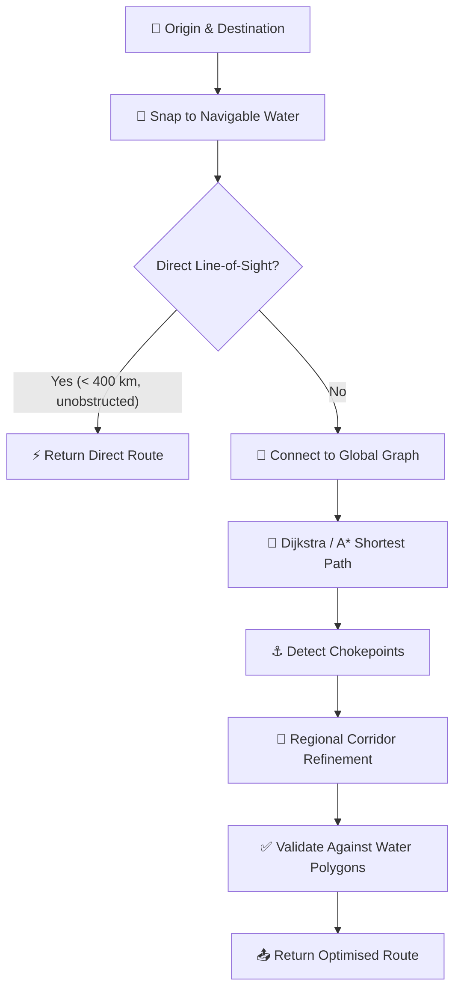

<p align="center">
  
</p>

<p align="center">
  <em>Intelligent shortest-path routing for global maritime navigation</em>
</p>

<p align="center">
  
  
  
  
  

</p>

---

## 🌊 What is VoyageIQ?

**VoyageIQ** is a full-stack maritime routing engine that computes the **shortest navigable sea route** between any two coordinates on Earth. Every route segment is validated against **1.2 GB of OpenStreetMap water-polygon geometry** to guarantee that ships never cross land — even through the world's narrowest straits and canal corridors.

Unlike simple great-circle or point-to-point distance calculators, VoyageIQ builds a real routing graph over the ocean surface and applies **hierarchical refinement** to produce routes that respect coastlines, island chains, and critical maritime chokepoints.

---

## ✨ Key Features

### 🧭 Routing Engine
- **Global shortest-path routing** using Dijkstra / A* on a precomputed ocean graph (~3,100 nodes · ~10,700 edges)
- **Geodesic distance calculation** on the WGS-84 ellipsoid via `pyproj` for sub-kilometre accuracy
- **Geometric land-avoidance** — every candidate edge is validated against high-resolution water polygons using a Shapely STRtree spatial index
- **Direct line-of-sight optimisation** — nearby open-water points bypass the graph entirely for instant results

### 🗺️ Multi-Level Regional Refinement
- **Level 1 — Coarse:** Fast global routing on the 3.5° grid
- **Level 2 — Standard:** Corridor re-meshing at 1.0° resolution around the coarse route
- **Level 3 — Ultra-Fine:** High-density refinement for maximum route accuracy
- Refinement operates within a **200 km corridor buffer** around the coarse path — no global graph blowup

### ⚓ Narrow-Strait & Canal Navigation
Dedicated corridor definitions with verified waypoint sequences for the world's most critical maritime passages:

| Chokepoint | Description |
|-----------|-------------|
| **Suez Canal & Red Sea Corridor** | Full transit from Mediterranean → Port Said → Great Bitter Lake → Gulf of Suez → Red Sea → Bab-el-Mandeb |
| **Bab-el-Mandeb Strait** | Red Sea ↔ Gulf of Aden connection |
| **Strait of Hormuz** | Persian Gulf ↔ Gulf of Oman |
| **Strait of Malacca & Singapore Strait** | Indian Ocean ↔ South China Sea |
| **Strait of Gibraltar & Alboran Sea** | Atlantic ↔ Mediterranean |
| **English Channel & Dover Strait** | Western Approaches ↔ North Sea |
| **Panama Canal** | Atlantic / Caribbean ↔ Pacific Ocean |

### 🔍 Chokepoint Detection
Every computed route automatically identifies which chokepoints were traversed, providing operational intelligence for voyage planning.

### 🖥️ Interactive Map Dashboard
A React + Leaflet frontend lets users:
- Select origin and destination from a curated port database or by clicking the map
- Choose from preset trade routes (Shanghai → Rotterdam, Dubai → Tokyo, New York → Piraeus, etc.)
- Toggle between coarse route, refined route, and chokepoint overlays
- Adjust refinement resolution in real time

---

## 🏗️ Architecture

```
┌──────────────────────────────────────────────────────────────────┐
│                   React / Leaflet Frontend                       │
│            TypeScript · Vite · TailwindCSS v4 · Leaflet          │
└───────────────────────────┬──────────────────────────────────────┘
                            │  REST / JSON
┌───────────────────────────▼──────────────────────────────────────┐
│                       FastAPI Backend                             │
│                                                                  │
│   ┌─────────────┐    ┌────────────────┐    ┌──────────────────┐  │
│   │  API Layer   │ →  │ Routing Service │ →  │    Regional      │  │
│   │  (REST API)  │    │  (Orchestrator) │    │   Refinement     │  │
│   └─────────────┘    └───────┬────────┘    └──────────────────┘  │
│                              │                                    │
│   ┌──────────────────────────▼─────────────────────────────────┐ │
│   │  Global Graph  ·  Spatial Index  ·  Chokepoint Corridors   │ │
│   │   (NetworkX)      (STRtree)        (Verified Waypoints)    │ │
│   └────────────────────────────────────────────────────────────┘ │
│                              │                                    │
│   ┌──────────────────────────▼─────────────────────────────────┐ │
│   │            Geospatial Data Layer                            │ │
│   │   GeoPandas · Shapely · PyOGRIO · Parquet Cache            │ │
│   └────────────────────────────────────────────────────────────┘ │
└──────────────────────────────────────────────────────────────────┘
```

---

## 🛠️ Tech Stack

| Layer | Technology |
|-------|-----------|
| **Backend** | Python 3.13 · FastAPI · Uvicorn · Pydantic v2 |
| **Routing** | NetworkX (Dijkstra / A*) · pyproj (geodesic) |
| **Geospatial** | GeoPandas · Shapely 2.0 · PyOGRIO · PyArrow / Parquet |
| **Frontend** | React 19 · TypeScript 6 · Vite 8 · TailwindCSS v4 · Leaflet 1.9 |
| **Testing** | pytest · HTTPX |

---

## 📁 Project Structure

```
maritime-route-engine/
│
├── app/                               # FastAPI backend
│   ├── api/
│   │   ├── routes.py                  # REST endpoints (/route, /health, /route/debug)
│   │   └── schemas.py                 # Pydantic request & response models
│   ├── core/
│   │   └── config.py                  # App settings, file paths, routing parameters
│   ├── geo/
│   │   ├── data_loader.py             # Water polygon loading (SHP → Parquet cache)
│   │   ├── geometry.py                # Geodesic distance & math utilities
│   │   └── spatial_index.py           # STRtree spatial index & water validation
│   ├── routing/
│   │   ├── chokepoints.py             # Strait & canal corridor definitions
│   │   ├── global_graph.py            # Precomputed ocean graph (build / load)
│   │   ├── local_routing.py           # Connect arbitrary coordinates to graph
│   │   ├── regional_refinement.py     # Multi-level corridor refinement engine
│   │   ├── route_validation.py        # Post-route land-crossing validation
│   │   └── shortest_path.py           # Dijkstra / A* wrapper
│   ├── services/
│   │   └── routing_service.py         # Full routing pipeline orchestrator
│   └── main.py                        # FastAPI application entry point
│
├── frontend/                          # React + Leaflet interactive map
│   ├── src/
│   │   ├── components/                # MapComponent, RouteSidebar, RouteResults, Navbar
│   │   ├── data/                      # Port database & chokepoint markers
│   │   ├── services/                  # API client
│   │   └── types/                     # TypeScript type definitions
│   ├── package.json
│   └── vite.config.ts
│
├── scripts/                           # Utility, debug & cache-build scripts
├── tests/                             # pytest test suite
├── data/                              # Water polygons & graph cache (not in repo)
├── docs/                              # Documentation assets
├── requirements.txt                   # Python dependencies
└── README.md
```

---

## 🚀 Getting Started

### Prerequisites

| Tool | Version |
|------|---------|
| **Python** | 3.11+ |
| **Node.js** | 18+ (for the frontend) |
| **Git** | any recent version |

### 1. Clone the repository

```bash
git clone https://github.com/suprithdotenv/maritime-route-engine.git
cd maritime-route-engine
```

### 2. Download the data files

The `data/` folder is **not included** in the repository due to its size (~2.4 GB).

Download the [OpenStreetMap Water Polygons (split, EPSG:4326)](https://osmdata.openstreetmap.de/data/water-polygons.html) shapefile and place it inside the project:

```
data/
├── water-polygons-split-4326/
│   ├── water_polygons.shp
│   ├── water_polygons.shx
│   ├── water_polygons.dbf
│   ├── water_polygons.prj
│   └── water_polygons.cpg
└── cache/                     # auto-generated on first run
```

### 3. Set up the backend

```bash
# Create a virtual environment
python -m venv venv

# Activate the virtual environment
# Windows (PowerShell)
.\venv\Scripts\Activate.ps1
# macOS / Linux
source venv/bin/activate

# Install dependencies
python -m pip install --upgrade pip
python -m pip install -r requirements.txt
```

### 4. Start the API server

```bash
python -m uvicorn app.main:app --host 127.0.0.1 --port 8000
```

On **first launch** the engine will:
1. Load water polygons from the shapefile and cache them as **Parquet** for faster subsequent loads
2. Build the global routing graph and cache it as a **pickle** file

Subsequent startups load from cache and are significantly faster.

### 5. Verify the server is running

```bash
curl http://127.0.0.1:8000/health
```

```json
{
  "status": "healthy",
  "data_loaded": true,
  "features_count": 42029,
  "graph_loaded": true,
  "graph_nodes": 3116,
  "graph_edges": 10718,
  "supported_chokepoints": [
    "Suez Canal & Red Sea Corridor",
    "Bab-el-Mandeb Strait",
    "Strait of Hormuz",
    "Strait of Malacca & Singapore Strait",
    "Strait of Gibraltar & Alboran Sea Corridor",
    "English Channel & Strait of Dover",
    "Panama Canal"
  ]
}
```

### 6. (Optional) Start the frontend

```bash
cd frontend
npm install
npm run dev
```

Open **http://localhost:5173** — the UI proxies API calls to the backend at port 8000.

---

## 📡 API Reference

### `GET /`

Returns API metadata, server status, and a list of all supported functionality.

### `GET /health`

Returns application health, data-load status, graph dimensions, and chokepoint support.

### `POST /route`

Compute the shortest maritime route between two coordinates.

**Request:**

```json
{
  "origin": { "lon": 32.30, "lat": 31.23 },
  "destination": { "lon": 103.85, "lat": 1.29 },
  "refinement_level": 2
}
```

| Field | Type | Default | Description |
|-------|------|---------|-------------|
| `origin` | `{lon, lat}` | *required* | Starting coordinate (WGS-84, decimal degrees) |
| `destination` | `{lon, lat}` | *required* | Ending coordinate (WGS-84, decimal degrees) |
| `refinement_level` | `1 \| 2 \| 3` | `1` | Coarse → Standard → Ultra-Fine |

**Response:**

```json
{
  "route_found": true,
  "coordinates": [[32.30, 31.23], [32.31, 31.17], "..."],
  "total_distance_km": 8432.17,
  "global_nodes_count": 3116,
  "global_edges_count": 10718,
  "regional_nodes_count": 487,
  "regional_edges_count": 1253,
  "refinement_level_reached": 2,
  "traversed_chokepoints": [
    "Suez Canal & Red Sea Corridor",
    "Bab-el-Mandeb Strait",
    "Strait of Malacca & Singapore Strait"
  ],
  "warnings": []
}
```

### `POST /route/debug`

Same as `/route` but includes an additional `debug` object with the coarse route, validation report, computation time, and diagnostics.

---

## 🧪 Running Tests

```bash
pytest -v
```

The test suite covers API endpoints, data loading, global routing, narrow-passage traversal, and regional refinement.

---

## 📊 How It Works



1. **Snap to Water** — Origin and destination coordinates are validated and snapped to the nearest navigable water polygon
2. **Line-of-Sight Check** — If the two points are close (< 400 km) and have an unobstructed water path, the route is returned immediately
3. **Global Graph Routing** — The coordinates are connected to the precomputed ocean graph, and Dijkstra's algorithm finds the shortest path
4. **Chokepoint Detection** — The coarse route is scanned to identify which maritime chokepoints it traverses
5. **Regional Refinement** — A higher-resolution sub-graph is built within a corridor around the coarse route, producing a smoother and shorter path
6. **Validation** — Every segment of the refined route is checked against water polygons to ensure no land crossings

---

## 🤝 Contributing

Contributions are welcome! Here's how to get started:

1. **Fork** the repository
2. Create a feature branch: `git checkout -b feature/my-feature`
3. Commit your changes: `git commit -m "Add my feature"`
4. Push to the branch: `git push origin feature/my-feature`
5. Open a **Pull Request**

Please ensure all tests pass before submitting a PR.

---

<p align="center">
  Built with ☕ and geodesic math &nbsp;·&nbsp; <a href="https://github.com/suprithdotenv/maritime-route-engine">github.com/suprithdotenv/maritime-route-engine</a>
</p>
